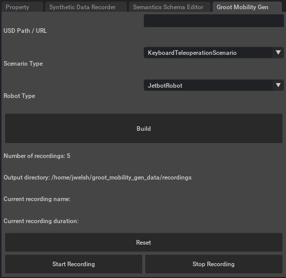

<h1 align="center"><span>PatoSim</span></h1>

<div align="center">
An underwater robotics simulator built on <a href="https://developer.nvidia.com/isaac/sim">NVIDIA Isaac Sim 5.1</a>
for collecting camera, sonar, lidar, DVL and barometer data with an ROV.
<br></br>

</div>

## Overview

PatoSim joins two projects in one Isaac Sim extension (`omni.ext.patosim`):

- the recording structure of [MobilityGen](https://github.com/NVlabs/MobilityGen): robot and scenario
  registries, two-phase recording (record poses online, render sensors offline) and the `Reader`/`Writer`;
- the underwater sensors of [OceanSim](https://umfieldrobotics.github.io/OceanSim/): underwater camera,
  imaging sonar, DVL and barometer, now imported as `omni.ext.patosim.oceansim` (inside the extension).

It provides

- ***Underwater robot***: `OceanSimROVRobot` (BlueROV, 6 DOF, thruster forces, BlueROV hydrodynamics).
- ***Sensors***: underwater RGB camera, stereo pair, imaging sonar (the default `raw` mode keeps the real
  range falloff), RTX lidar with an underwater range/attenuation profile, DVL and barometer. **All sensors
  start off** (lightweight navigation): tick only the ones a recording needs.
- ***Scenarios***: keyboard teleoperation, gamepad teleoperation (6 DOF), waypoints and autonomous path
  following (`OceanSimROV*Scenario`).
- ***World Builder***: a second, robot-free launcher that loads a world, imports dataset objects and
  checks/applies the semantic classes, sonar reflectivity and collisions the sensors need, before recording.
- ***Ground truth***: robot and sensor poses (world frame), sensor extrinsics, occupancy map (2D band or 3D
  stack) and, after the offline replay, RGB, depth, segmentation, instance segmentation, normals, sonar and
  point clouds.

Robots and scenarios are extensible: subclass [Robot](./exts/omni.ext.patosim/omni/ext/patosim/robots.py)
or [Scenario](./exts/omni.ext.patosim/omni/ext/patosim/scenarios.py) and register them.

## Table of Contents

- [🛠 Setup & Installation](#setup)
- [👍 Basic Usage](#usage)
- [🌍 World Builder](#world-builder)
- [✅ Tests](#tests)
- [🚧 TODO / Roadmap](#todo)
- [💡 How To Guides](#guides)
    - [How to record autonomous data](#how-to-procedural-data)
    - [How to implement a custom robot](#how-to-custom-robot)
    - [How to implement a custom scenario](#how-to-custom-scenario)
- [📝 Data Format](#-data-format)
- [👏 Contributing](#-contributing)

<a id="setup"></a>
## 🛠 Setup & Installation

Follow these steps to set up PatoSim and its C++ dependencies. Tested with **Isaac Sim 5.1.0** on an
RTX 4070 (driver 565) and an RTX 5060 Ti (driver 580).

### Step 1 — Locate or Install Isaac Sim
Download the **NVIDIA Isaac Sim 5.1.0** standalone package and extract it.
* Note down its absolute folder path (e.g., `~/isaacsim`, `~/Downloads/isaac-sim`, or `/opt/isaac-sim`).

---

### Step 2 — Clone the Repository
```bash
git clone https://github.com/PDI-DL/PatoSIM.git PatoSim
cd PatoSim
```
*Always keep your terminal session inside the repository root (`PatoSim/`) for the following steps.*

---

### Step 3 — Link Isaac Sim to the Project
The project uses a local `./app` link to Isaac Sim (`./app/python.sh` and `./app/isaac-sim.sh` are used
below). Pass the **exact folder path** where your Isaac Sim is located:

```bash
./link_app.sh --path ~/isaacsim
```

---

### Step 4 — Install Core Python Dependencies
Install them with the Python interpreter bundled with Isaac Sim:

```bash
./app/python.sh -m pip install tqdm wheel
```

---

### Step 5 — Install the C++ Path Planner
The `path_planner` module compiles C++ bindings. Install `pybind11` first and skip pip's build isolation:

```bash
cd path_planner
../app/python.sh -m pip install pybind11
../app/python.sh -m pip install --no-build-isolation -e .
cd ..
```

---

### Step 6 — Get the Assets
The worlds, the BlueROV model and the dataset objects are in the public Hugging Face dataset
[`PDI-DL/PatoSimAssets`](https://huggingface.co/datasets/PDI-DL/PatoSimAssets). Download them into
`assets/models` with any Python 3 that has `huggingface_hub`:

```bash
python3 -m pip install huggingface_hub hf_transfer
python3 scripts/assets/downloadAll.py   # PDI-DL/PatoSimAssets -> assets/models
```

(`scripts/assets/assets.sh -auth / -download / -upload` works on a git clone of the private `PDI-DL/PDI_3DUW`
dataset and needs a Hugging Face login with access to it.)

PatoSim also finds the same folders (`worlds/`, `bluerov/`, `plataforms/`, `statues_temples/`, `scenario/`)
directly under `assets/`, the layout some machines already use.

Optional environment variables: `PATOSIM_DEV_SCENE` (world loaded by the **Use MHL Scene** button; default
`worlds/Prototipo1/world.usd` from the assets) and `PATOSIM_DATA` (data folder, default `~/PatoSimData`).

---

### Step 7 — Check the Installation
```bash
./app/python.sh -c "import tqdm, mobility_gen_path_planner; print('ok')"
./app/python.sh tests/integration/run_worldbuilder_extension_check.py   # ~1 min, headless
```
See [Tests](#tests) for the full checks.

---

### Step 8 — Launch PatoSim
Always launch from the **repository root**:

```bash
./scripts/launch_patosim.sh        # main simulator (robot, sensors, recording)
./scripts/launch_world_builder.sh  # World Builder (worlds only, no robot)
```
If everything worked, Isaac Sim opens with the **PatoSim** window.

<a id="usage"></a>
## 👍 Basic Usage

A typical session: open a world, drive the ROV, turn on the sensors you need, record, then render the
sensor data offline.

### Step 1 - Launch PatoSim

```bash
./scripts/launch_patosim.sh
```

### Step 2 - Build a scenario

In the **PatoSim** window:

1. Click **Use MHL Scene** (fills **USD Path / URL** with the example world) or paste the path of another
   world `.usd` (prepare new worlds in the [World Builder](#world-builder) first).
2. **Scenario Type**: `OceanSimROVTeleoperationScenario` (keyboard). Other options:
   `OceanSimROVGamepadTeleoperationScenario`, `OceanSimROVWaypointScenario`,
   `OceanSimROVPathFollowingScenario`.
3. **Robot Type**: `OceanSimROVRobot`.
4. Click **Build**. The world, the ROV and the occupancy map appear after a few seconds.

All sensors start **off**, so driving stays fluid. To record sensor data, open **Robot Setup** and tick the
sensors under **Sensors** (Front Camera, Stereo, LiDAR, Sonar, DVL, Barometer) **before Build**. The same
window sets the speeds, the operating **Depth (m)** and **Sonar Refl.** (apply sonar reflectivity to the world
meshes on Build).

### Step 3 - Drive the ROV

| Keys | Motion |
|---|---|
| `W` / `S` | forward / backward (surge) |
| `A` / `D` | left / right (sway) |
| `↑` / `↓` | up / down (heave) |
| `J` / `L` | turn left / right (yaw) |
| `I` / `K` | pitch |
| `←` / `→` | roll |

With `OceanSimROVGamepadTeleoperationScenario`: left stick = surge/sway, right stick = heave/yaw (deadzone and
expo in `Config`). If the gamepad disconnects the command goes to zero.

**Reset** respawns the robot. **Window Manager** shows/hides the tool windows: **Sensor Preview** (camera
and sonar fan/grid, with update intervals), **LiDAR Preview** (top-down), **Occupancy Map**, **Path Planning**
(parameters of the legacy ground-robot path following) and **Dataset Object** (insert an object into the
world on Build).

### Step 4 - Record

1. Click **Start Recording**, drive, then **Stop Recording** (**Recording Settings** shows the status and the
   output folder).

Recordings go to `~/PatoSimData/recordings/<date-time>/` (`config.json`, `stage.usd`,
`sensors_extrinsics.json`, occupancy map, per-step state and, if the sonar is on, `state/sonar/raw`).

### Step 5 - Render the sensor data (offline replay)

Close Isaac Sim and render every recording (images, depth, segmentation, sonar, point clouds):

```bash
python scripts/replay_directory.py --render_interval=20
```

`--render_interval=20` renders one frame every 20 physics steps. The results go to `~/PatoSimData/replays`.
`python scripts/replay_directory.py --help` lists the options (modalities, point clouds, 2D annotations).

### Step 6 - Visualize the data

```bash
python examples/04_visualize_gradio.py   # then open http://127.0.0.1:7860
python scripts/sonar_viz.py --help       # sonar frames
```

<a id="world-builder"></a>
## 🌍 World Builder

`./scripts/launch_world_builder.sh` opens Isaac Sim with only the `omni.ext.patosim_worldbuilder` extension:
no robot, no sensors, no recording UI. Use it to prepare a world before recording:

1. **Load World (no robot)**: paste the world `.usd` path.
2. **Import Dataset Object**: pick an asset from `plataforms/`, `statues_temples/` or `scenario/`, set
   position, rotation, scale and reflectivity, **Insert Object Into World**.
3. **Check Semantic Classes** → **Apply Default Reflectivity**: meshes without the `class`/`reflectivity`
   labels get a default sonar reflectivity (without them the sonar uses a default value that looks fine but is
   wrong for a dataset).
4. **Check Physics** → **Apply Physics (Collisions)**: geometry without a collision API is invisible to
   sonar/lidar raycasts and ROV collisions.

The fixes act on the open stage. **Build** in `launch_patosim.sh` already enables collisions on the whole
world and, with **Sonar Refl.** on, applies the default reflectivity; the World Builder shows beforehand what a
world is missing (e.g. meshes without a semantic class) so you can fix the world file itself.

Details: [exts/omni.ext.patosim_worldbuilder/docs/README.md](./exts/omni.ext.patosim_worldbuilder/docs/README.md).

<a id="tests"></a>
## ✅ Tests

```bash
python3 -m pytest tests/unit                                            # 32 pure tests, no Isaac (needs pytest)
./app/python.sh tests/integration/run_gpu_integration_checks.py        # Isaac headless, 1-3 min
./app/python.sh tests/integration/run_worldbuilder_extension_check.py  # Isaac headless, ~1 min
```

The integration checks build a full ROV scenario with every sensor, record a short session, check the World
Builder tools, the 3D occupancy map stack and the gamepad scenario, and confirm the sonar code comes from this
repository. Results are printed and saved to `tests/integration/last_*_results.json`.
`PATOSIM_LEGACY_RECORDING=<recording>` sets the old recording used by the config backward-compatibility
check (skipped when absent).

<a id="contributing"></a>
<a id="todo"></a>
## 🚧 TODO / Roadmap

Below is the current implementation checklist for turning PatoSim into a complete underwater simulation and dataset-generation tool.

- `Worlds / scene usage`: define which underwater worlds are officially supported, separate test/demo worlds from production worlds, and document how scenes should be loaded from local assets vs external OceanSim assets.
- `Default assets folder`: standardize one default asset root for OceanSim-style assets, improve fallback behavior when assets are missing, and reduce the need for manual path registration.
- `Robot modeling with underwater sensors`: consolidate the underwater robot model so the base vehicle, mounts and sensor frames are defined in a reusable way instead of being scattered across UI setup code.
- `Sensor data recording`: extend the recording pipeline to persist underwater-camera outputs, sonar products, DVL, barometer and any metadata needed for replay and dataset generation.
- `UI adjustments`: redesign the main PatoSim UI so world loading, robot selection, sensor toggles, water profiles and recording controls are exposed from a single coherent interface.
- `scenarios.py adjustments`: add scenario classes specific to underwater operation, object scanning and asset-aware missions, while preserving the existing scenario registry pattern.
- `Waypoint navigation and keyboard teleop`: adapt control logic for underwater vehicles so waypoint following and keyboard teleoperation work with submerged robot dynamics rather than ground-robot assumptions.
- `Sensor implementation review`: validate sensor update rate, rendering triggers, output format and synchronization between simulation step and logging step.
- `Sensor pose calibration`: review and fix the physical placement, rotation and mounting offsets of sonar, cameras, DVL and barometer on each robot model.
- `Robot class registry`: register underwater robot types following the same structure as the former MobilityGen robot registry, but backed by OceanSim assets and PatoSim-specific parameters.
- `Dynamic object tool`: create a tool to swap scanned objects and scene props quickly, enabling variation of environments and interaction targets without editing the stage manually.
- `Object scanning scenario`: implement a dedicated scanning scenario for orbiting or circling objects, generating multi-view underwater datasets for reconstruction, detection or inspection pipelines.
- `Dataset profiles`: define dataset presets that bundle robot type, sensor configuration, water profile, world, scenario and output format into reusable experiment recipes.
- `OceanSim integration cleanup`: move the remaining compatibility glue into a clearly named integration layer so the runtime path is easier to understand and maintain.


<a id="guides"></a>
## 💡 How To Guides

<a id="how-to-procedural-data"></a>
### How to record autonomous data

1. Launch PatoSim (`./scripts/launch_patosim.sh`) and fill **USD Path / URL** as in the basic usage.
2. **Scenario Type** and **Robot Type** (`OceanSimROVRobot`):
    - `OceanSimROVPathFollowingScenario`: random 3D goals, a path planned on the occupancy map (XY) with a
      linear depth profile, followed with pure pursuit and replanned at each goal. Its parameters (XY/Z speed,
      yaw gain, lookahead, goal threshold, goal depth range `rov_path_z_min`/`rov_path_z_max`) are attributes
      of the scenario class in `scenarios.py`; the **Path Planning** window currently only edits the legacy
      ground-robot scenario.
    - `OceanSimROVWaypointScenario`: follows the waypoints of `exts/omni.ext.patosim/demo/demo_waypoints.txt`
      (one `x y z qw qx qy qz` per line) or of the file in `$PATOSIM_ROV_WAYPOINTS`.
3. Tick the sensors you need in **Robot Setup**, click **Build**, then **Start Recording**.
4. **Stop Recording** when done; render and visualize as in Steps 5-6 of the basic usage.

<a id="how-to-custom-robot"></a>
### How to implement a new robot

You can implement a new robot for use with PatoSim.

The general workflow is as follows:

1. Subclass the [Robot](exts/omni.ext.patosim/omni/ext/patosim/robots.py) class.
2. Implement the ``build()`` method.  This method is responsible for adding the robot to the USD stage.
2. Implement the ``write_action()`` method.  This method applies the action (for ``OceanSimROVRobot``, the 6-DOF body force/torque).
3. Overwrite the common class parameters (like ``physics_dt``, ``occupancy_map_z_min``, etc.)
4. Register the robot class by using the ``ROBOT.register()`` decorator.  This makes the custom robot discoverable.

We recommend referencing the example robots in [robots.py](exts/omni.ext.patosim/omni/ext/patosim/robots.py) for more details.

A good way to start could be simply by modifying an existing robot.  For example, you might change the position at which
a sensor is mounted on ``OceanSimROVRobot``.

<a id="how-to-custom-scenario"></a>
### How to implement a new scenario

You can implement a new data recording scenario for use with PatoSim.

The general workflow is as follows:

1. Subclass the [Scenario](exts/omni.ext.patosim/omni/ext/patosim/scenarios.py) class.
2. Implement the ``reset()`` method.  This method is responsible for randomizing / initializing the scenario (ie: spawning the robot).
3. Implement the ``step()`` method.  This method is responsible for incrementing the scenario by one physics step.
4. Register the scenario class by using the ``SCENARIOS.register()`` decorator.  This makes the custom scenario discoverable.

We recommend referencing the example scenarios in [scenarios.py](exts/omni.ext.patosim/omni/ext/patosim/scenarios.py) for more details.

A good way to start could be simply by modifying an existing scenario.  For example, you might implement a new method
for generating random motions.

## 📝 Data Format

PatoSim records two types of data.

- *Static Data* is recorded at the beginning of a recording
    - Occupancy map
    - Configuration info
        - Robot type
        - Scenario type
        - Scene USD URL
    - USD Stage
- *State Data* is recorded at each physics timestep
    - Robot action: Linear, angular velocity
    - Robot pose: Position, quaternion
    - Robot joint Positions / Velocities
    - Robot sensor data:
        - Depth image
        - RGB Image
        - Segmentation image / info
        - Instance Segmentation
        - Normals

This data can easily be read using the [Reader](./examples/reader.py) class.

```python
from reader import Reader

reader = Reader(recording_path="replays/2025-01-17T16:44:33.006521")

print(len(reader)) # print number of timesteps

state_dict = reader.read_state_dict(0)  # read timestep 0
```

The state_dict has the following schema

```
{
    "robot.action": np.ndarray,                                      # [2] - Linear, angular command velocity
    "robot.position": np.ndarray,                                    # [3] - XYZ
    "robot.orientation": np.ndarray,                                 # [4] - Quaternion
    "robot.joint_positions": np.ndarray,                             # [J] - Joint positions
    "robot.joint_velocities": np.ndarray,                            # [J] - Joint velocities
    "robot.front_camera.left.rgb_image": np.ndarray,                 # [HxWx3], np.uint8 - RGB image
    "robot.front_camera.left.depth_image": np.ndarray,               # [HxW], np.fp32 - Depth in meters
    "robot.front_camera.left.segmentation_image": np.ndarray,        # [HxW], np.uint8 - Segmentation class index
    "robot.front_camera.left.segmentation_info": dict,               # see Isaac replicator segmentation info format
    "robot.front_camera.left.position": np.ndarray,                  # [3] - XYZ camera world position
    "robot.front_camera.left.orientation": np.ndarray,               # [4] - Quaternion camera world orientation
    ...
}
```

### Pose convention

- **Frame**: all `*.position` / `*.orientation` buffers (robot and every
  sensor: front_camera, front_stereo.left/right, sonar, lidar, dvl,
  barometer) are recorded in **world frame**, in meters, read from Isaac
  Sim's `get_world_pose()` every physics step.
- **Quaternion order**: **scalar-first, `[w, x, y, z]`** — the convention
  used throughout `isaacsim.core` (`euler_angles_to_quat`,
  `XFormPrim.get_world_pose()`), not the `[x, y, z, w]` order used by some
  other libraries (e.g. ROS, scipy's default). Convert explicitly if your
  downstream tooling expects `xyzw`.
- **Relative (robot-to-sensor) extrinsics**: recorded once per recording in
  `sensors_extrinsics.json` (next to `config.json`/`stage.usd`), since every
  sensor is rigidly mounted and its body-frame offset is constant for the
  whole recording. Combine with the per-frame `robot.position`/
  `robot.orientation` to reconstruct `T_world_sensor` without relying only on
  the (noisier, more expensive) per-frame world-frame sensor buffers, or use
  those per-frame buffers directly as a cross-check.
- **Underwater robot action vector**: for `OceanSimROVRobot`,
  `robot.action` is `[6]` (body-frame `[Fx, Fy, Fz, Tx, Ty, Tz]`
  force/torque), not the `[2]` (linear, angular) convention of the original
  ground-robot `Robot` base class shown above.

The ``Reader`` class abstracts away the details of reading the state dictionary
from the recording.

In case you're interested, each recording is represented as a directory with the following structure

```
2025-01-17T16:44:33.006521/
    occupancy_map/
        map.png
        map.yaml
    occupancy_map_3d/        # only with occupancy_map_mode = "3d_stack"
        manifest.json
        band_00/ ...
    config.json
    sensors_extrinsics.json  # fixed body-to-sensor transform of each active sensor
    stage.usd
    state/
        sonar/
            raw/             # raw sonar frames (.npy), written during the live recording
                00000000.npy
                ...
        common/
            00000000.npy
            00000001.npy
            ...
        depth/
            robot.front_camera.left.depth_image/
                00000000.png
                00000001.png
                ...
            robot.front_camera.right.depth_image/
                ...
        rgb/
            robot.front_camera.left.rgb_image/
                00000000.jpg
                00000001.jpg
            robot.front_camera.right.rgb_image/
                ...
        segmentation/
            robot.front_camera.left.segmentation_image/
                00000000.png
                00000001.png
                ...
            robot.front_camera.right.segmentation_image/
                ...
        normals/
            robot.front_camera.left.normals_image\
                00000000.npy
                00000001.npy
                ...

```

Most of the state information is captured under the ``state/common`` folder, as dictionary in a single ``.npy`` file.

However, for some data (images) this is inefficient.  These instead get captured in their own folder based on the data
type and the name.  (ie: rgb/robot.front_camera.left.depth_image).

The name of each file corresponds to its physics timestep.

If you have any questions regarding the data logged by PatoSim, please [let us know!](https://github.com/NVlabs/PatoSim/issues)

### Converting to the LeRobot Format

A script that converts a PatoSim recording/replay to a [LeRobot](https://github.com/huggingface/lerobot) dataset can be found at [scripts/convert_to_lerobot.py](./scripts/convert_to_lerobot.py). The [LeRobot Python package](https://github.com/huggingface/lerobot?tab=readme-ov-file#installation) needs to be installed before executing the script.

Example usage for converting a single recording:
```
python ./scripts/convert_to_lerobot.py \
  --input "~/PatoSimData/replays/2025-00-00T00:00:00.000000" \
  --output "/output/path" \
  --fps 30
```

Example usage for converting a collection of recordings:
```
python ./scripts/convert_to_lerobot.py \
  --input "/path/to/directory/containing/the/recordings" \
  --output "/output/path" \
  --batch \
  --fps 30
```

## 👏 Contributing
This [Developer Certificate of Origin](https://developercertificate.org/) applies to this project.

### Core Contributor
John Welsh, Huihua Zhao, Vikram Ramasamy, Wei Liu, Joydeep Biswas, Soha Pouya, Yan Chang
